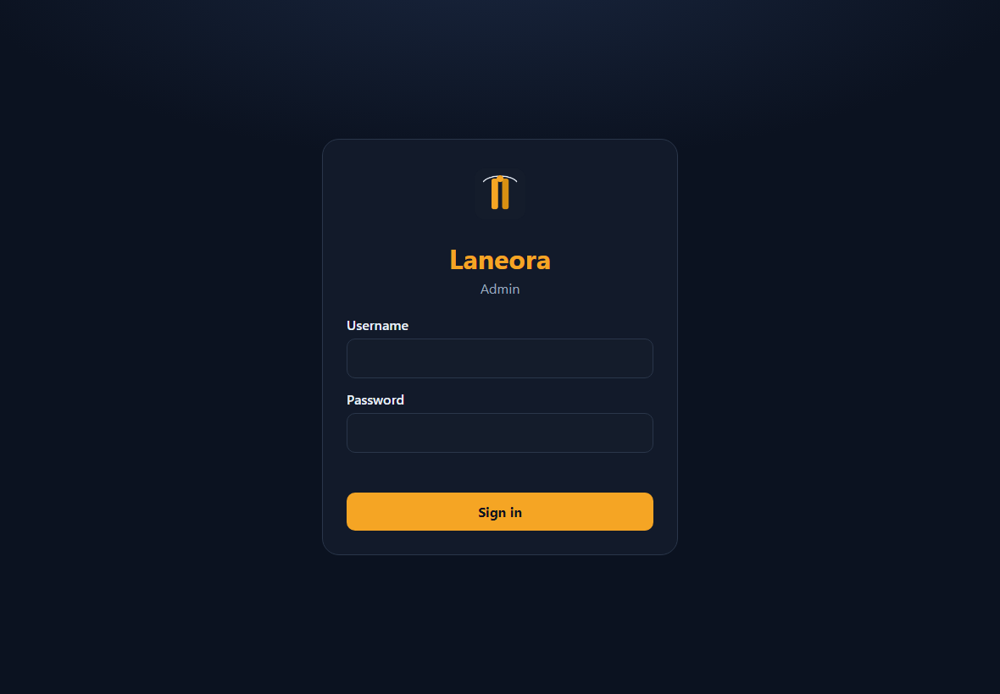
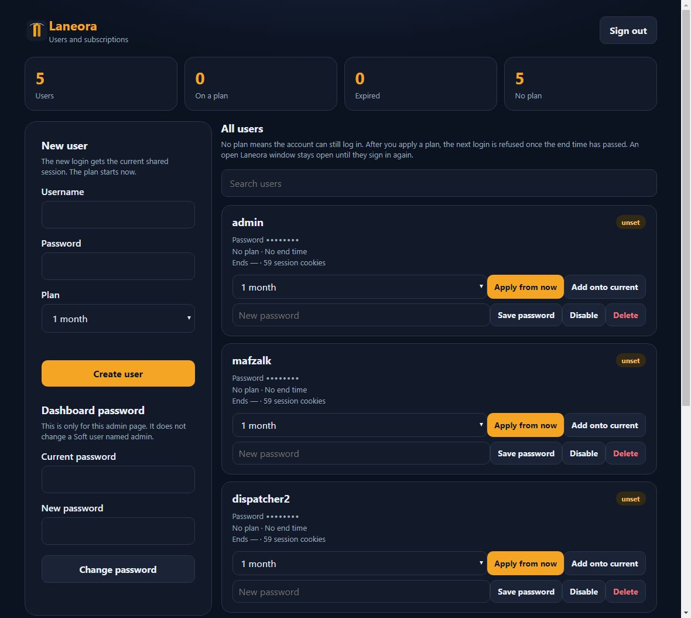
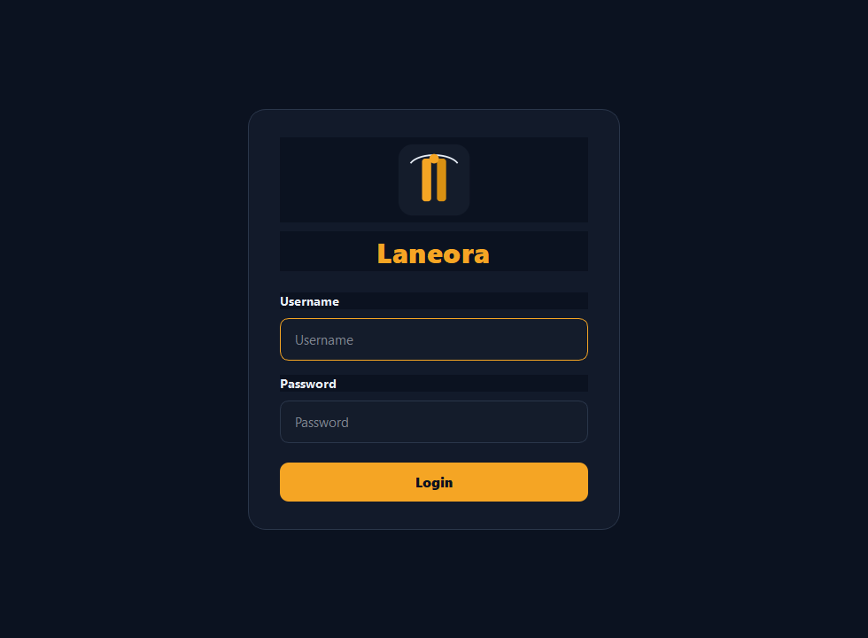

<div align="center">


# Laneora

**Windows desktop client for shared freight-board access, with an admin desk for users and plans**

Dispatchers sign in with a Laneora username. The app opens the load search already signed in. An admin creates those usernames, sets how long they last, and keeps one board session for every client.

[](https://www.python.org/)
[](https://www.riverbankcomputing.com/software/pyqt/)
[](#setup-windows)
[](https://github.com/mafzalkalwardev/laneora)
[](https://github.com/mafzalkalwardev/laneora/releases)

[How it works](#how-the-whole-system-works) · [Admin](#admin-dashboard) · [Client](#client-sign-in) · [Techniques](#techniques) · [Setup](#setup-windows)

</div>

---

## Why Laneora?

Laneora is a dispatch desktop app. The person at the client PC never types a board username or password. They type the Laneora username an admin created. The Soft server checks that login, checks the plan, and hands back one shared board session. The window then opens the load search inside an embedded browser.

The admin desk is a web page on the same server. From there you create users, set a plan, extend time, change a password, disable an account, or delete it. There is no seat cap. The same username cannot stay open on two Laneora windows at once.

**Repository:** https://github.com/mafzalkalwardev/laneora

---

## How the whole system works

Three pieces have to be up. They are not the same window.

| Piece | What it is | What happens if it stops |
| --- | --- | --- |
| Soft server | `Start Soft Server.bat` on the admin PC, port 8787 | New client logins fail. A search page that is already open stays open and retries. |
| Admin dashboard | Browser page at `/admin` on that server | You cannot create or change users until you open it again. Clients are not affected. |
| Laneora window | The desktop app on each dispatcher PC | Only that one screen closes. Other PCs keep working. |

```text
Admin PC                         Dispatcher PC
-----------                      --------------
Soft server  <---- login ----   Laneora window
   |                               |
   | users, plans, session         | embedded browser
   v                               v
Admin dashboard                 Load search
```

### 1. The server stays up

Double-click `Start Soft Server.bat`. It listens on `0.0.0.0:8787`. Clients connect to this PC’s LAN address, for example `http://192.168.1.20:8787`. They must not use `0.0.0.0`, and another PC cannot use `127.0.0.1`.

Closing the Laneora window does not stop the server. Sleep, shutdown, or closing the server window does. A page that is already open keeps retrying the once-a-minute check. When the server is back, that check succeeds again.

### 2. The admin creates a user and a plan

Open `http://127.0.0.1:8787/admin` and sign in. The login card leaves the page. The user list is the page.



Create a username, a password, and a plan. The plan starts at that moment. A new account also receives the board session that was last captured on the admin PC, so the dispatcher can open the search without a board login.

Plans:

| Plan | Length |
| --- | --- |
| Trial | 1 hour |
| Day | 1 day |
| Week | 7 days |
| 15 days | 15 days |
| Month | 30 days |
| 3 months | 90 days |
| 6 months | 180 days |
| Year | 365 days |

**Apply from now** replaces the clock and starts the chosen plan immediately. **Add onto current** adds that same length onto time that is still left. If the plan has already ended, add-on starts from now.

Accounts that have never been given a plan can still sign in. The clock starts only when you apply one. After the end time, the next Laneora login is refused. A window that is already open stays open until that person signs in again.



You can also change a user’s password, disable the account, or delete it. Disabling blocks the next login even if time is left. Deleting removes the Soft login. The dashboard password is separate from any client user, including a client user named admin.

### 3. The dispatcher signs in

The client window shows the Laneora icon, the name, username, password, and Login. Nothing else.



A correct login shows **Login Successful**. The next screen has one button, which opens the load search. The app does not offer a second board product.

On a dispatcher PC, run `dist\Laneora.exe` from `dist\Laneora Soft.bat`. The bat sets the server address. On this LAN that address is `http://192.168.1.20:8787`. If the admin PC cannot be reached, the client does not start an empty local server of its own.

### 4. The shared session opens the search

At login the server returns an encrypted session blob. Laneora decrypts it, writes the cookies into the embedded browser, and opens the search page. The dispatcher does not type a board password.

Every client PC must leave through the same static US address as the PC that captured the session. Laneora does not assign that address itself when the shared proxy is `none`. A static-IP VPN on each PC is what keeps the board looking at one egress address. If a PC uses a different public address, the board can reject the session.

Do not confirm a prompt that would sign the other computer out. That drops the shared session for everyone.

### 5. One screen per username

After login, the client calls the server about once a minute. With single-screen mode on, the newest Laneora window for that username wins. An older window is told to exit. Extra Chrome windows are not Laneora users. They do not count as a second screen, and they do not get their own board login.

### 6. When something expires

| What ended | What the dispatcher sees | What you do |
| --- | --- | --- |
| The plan’s end time | The next login is refused | Apply a plan again, or add time, from the admin desk |
| The account was disabled | The next login is refused | Enable the user |
| The board session went stale | The search asks for a board login, or the page fails to settle | Capture the session again on the admin PC and push it to every user |
| The Soft server is down | A new login cannot connect. An open search stays up and retries | Start `Start Soft Server.bat` again |

Refreshing cookies is still a capture on the admin PC while the static IP is on, then a push to all users. Clients pick up the new session the next time they sign in.

---

## Client sign-in

1. Same static US egress address as the admin PC.
2. Soft server running on the admin PC.
3. Laneora Soft username and password from the admin desk.
4. Login, then the single button that opens the load search.

Operator notes for handing a PC to someone are in `CLIENT_INSTALL.md`. Day-to-day server commands are in `ADMIN_OPS.md`.

---

## Techniques

This is the stack behind the workflow above.

| Technique | Where it is used |
| --- | --- |
| PyQt5 and Qt WebEngine | The client UI and the embedded Chromium window that shows the load search |
| Soft-compatible HTTP API | `GET /authenticate` checks the username, password, plan, and returns the encrypted session. `GET /logger` is the once-a-minute screen check |
| Subscription clock | Plan start and end are stored in UTC on the account. Login is refused when the end time has passed or the account is disabled |
| OpenSSL-compatible AES payload | The session blob is `Salted__` AES, decrypted in the client before cookies are applied |
| Cookie restore | Cookie expiry from the capture is unix time, written into the WebEngine cookie store, then the search URL loads |
| Document script | After the page starts, a script keeps the view on the search route and hides the side menu, insurance banner, and mailbox connect button |
| Single-screen heartbeat | The server remembers the newest login for that username and answers the older window with a failed check |
| Explicit Windows app id | The taskbar icon is the Laneora mark, set before the first window, instead of the Python icon |
| PyInstaller onefile build | `build.ps1` produces `dist\Laneora.exe` with the mark as the program icon |

A shared HTTP proxy is optional. If you set one, every account receives the same proxy host on the next login, and the board sees that proxy’s egress address instead of each PC’s own address.

```powershell
python scripts\soft_admin.py set-proxy PROXY_HOST PROXY_PORT PROXY_USER PROXY_PASS
python scripts\soft_admin.py check-ip
python scripts\soft_admin.py status
```

---

## Setup (Windows)

```powershell
cd "d:\Dispatch Softwares\Laneora"
py -3 -m venv .venv
.\.venv\Scripts\Activate.ps1
pip install -r requirements.txt
python scripts\make_brand.py
```

Then start the server, then the client:

```powershell
.\Start Soft Server.bat
.\Start Laneora.bat
```

**Requirements:** Windows 10/11, Python 3.12+.

The server does not invent a dashboard login. Set one on the server with `python scripts/soft_admin.py dashboard-set --generate-username --generate-password`, then store the line it prints. That login is separate from every client user, including a client named admin. See `ADMIN_OPS.md` for password storage, session revocation, and the one-time migration of existing logins.

Point a client at the server:

```powershell
$env:LANEORA_SERVER_URL = "http://127.0.0.1:8787"
$env:LANEORA_SKIP_UPDATE = "1"
python -m app
```

Build the program you send to a dispatcher:

```powershell
powershell -ExecutionPolicy Bypass -File .\build.ps1
```

Output: `dist\Laneora.exe`, started by `dist\Laneora Soft.bat`.

---

## Check that it works

1. Start the Soft server and open http://127.0.0.1:8787/admin
2. Sign in. The login card is gone and the user list is the page
3. Create a user with a plan, or use an account that has no plan yet
4. Run the client, sign in, and open the load search
5. Put an end time in the past and confirm the next login is refused

---

## Keywords

Laneora, freight dispatch desktop software, shared load-board session, dispatcher subscription plans, Windows load search client, PyQt5 Qt WebEngine browser, cookie session restore, AES encrypted stream payload, single-screen login heartbeat, multi-user dispatch access, static egress IP for one board session, PyInstaller Windows desktop build.

---

## Release

Current version: **v3.0.0** ([releases](https://github.com/mafzalkalwardev/laneora/releases)).

Account passwords and captured board cookies stay in `data/` on the server PC. Do not commit those files. Program builds are gitignored (`dist/`, `*.exe`).

---

<div align="center">

**Laneora** — one board session, many dispatchers, plans you control

</div>
